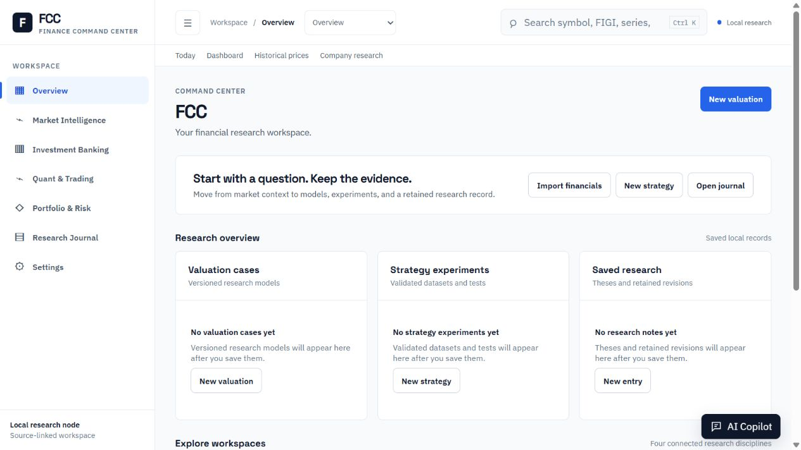
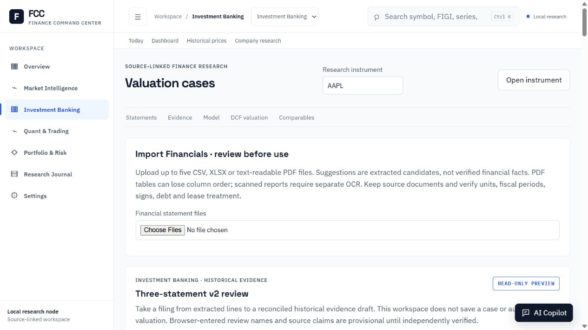

# FCC — Finance Command Center

FCC (formerly Deck) is a local finance research workbench for financial modeling, market inspection, strategy experiments, portfolio review, and an evidence-linked journal. The repository URL and original project history remain [deck-finance-command-center](https://github.com/Y-Jakhar/deck-finance-command-center).

The light interface has seven workspaces: Overview, Market Intelligence, Investment Banking, Quant & Trading, Portfolio & Risk, Research Journal, and Settings. The Overview lists saved local records from the application API; it does not display illustrative financial figures as live data. Navigation and layout adapt to desktop and tablet widths, and motion respects reduced-motion preferences.

The React/TypeScript frontend is served by a loopback FastAPI backend. It starts with a new empty SQLite database without sibling repositories. Go-Terminal, DealLens, and StrategyLab are optional local integrations; their provider-backed features show an unavailable state when the corresponding engine is absent. No sibling source, downloaded market data, private research, or production database is packaged.

## Workspaces

| Workspace | Available in standalone mode | Optional boundary |
| --- | --- | --- |
| Home and Settings | Navigation, storage and provider status | AI providers require backend credentials. |
| Markets | Empty watchlist and clear unavailable states | Go-Terminal supplies instruments, quotes, and history. |
| Investment Banking | Statement import, independent modeling previews, versioned DCF, and journal links | DealLens supplies legacy v1 valuation; evidence acceptance remains separately controlled. |
| Quant & Trading | Workspace and import form | StrategyLab supplies validation, simulation, and run artifacts. Simulated fills are not orders. |
| Portfolio & Risk | Empty state and saved-record views | New calculations require validated datasets. |
| Research Journal | Local entries, revisions, and exports | Records are private to the local runtime directory. |

See [features and limitations](docs/FEATURES_AND_LIMITATIONS.md) for what each workspace does and does not claim.

## Install and run

The verified environment is Python 3.13, Node.js 24/npm, and Windows PowerShell. Use a new private runtime directory. Follow the [installation guide](docs/INSTALLATION.md) for the exact commands and clean-start checks. The backend listens on `127.0.0.1:8010`; it is not an authenticated public server.

## Tests

From a fresh environment, install `requirements-lock.txt`, run `python -m pip check`, `python -m pytest -q tests`, and `python -m ruff check` on the listed application/test modules. In `frontend`, run `npm ci`, `npm test`, `npm run lint`, `npm run build`, and `npm audit --audit-level=low`. The [light-theme verification](docs/LIGHT_THEME_RELEASE.md) records current checks and remaining limits; the [original publication clearance](docs/FINAL_GITHUB_RELEASE_APPROVAL.md) remains a historical record.

## License and attribution

Copyright (c) 2026 Yash Jakhar. Deck source owned by Yash Jakhar is licensed under [MIT](LICENSE). Third-party dependencies, fonts, and any separately licensed material retain their own terms; see [third-party notices](THIRD_PARTY_NOTICES.md). The owner authorized MIT distribution of the Go-Terminal and DealLens code they own that is included here. No optional sibling repository is bundled.

No investment result, market feed, backtest, or AI response is guaranteed. Do not put credentials, real portfolio records, licensed datasets, or protected research in a public repository.
